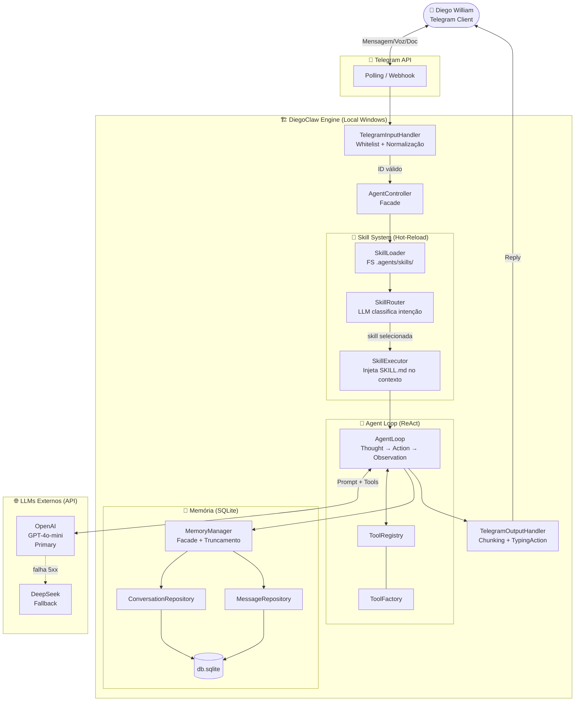
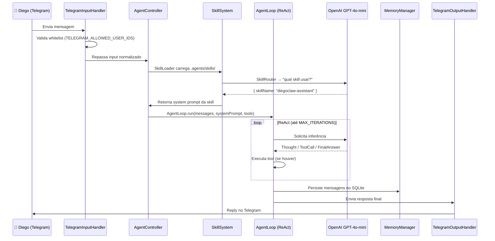

# DiegoClaw — Arquitetura

**Versão:** 2.0  
**Status:** Ingested & Active (93 Obras + OCR)  
**Data:** 2026-07-31  
**Tech Lead:** Diego William  

---

## 1. Visão Geral

O **DiegoClaw** é um agente de IA pessoal local de Diego William. Ele roda no desktop Windows, é controlado exclusivamente via **Telegram**, e utiliza LLMs externos apenas para inferência. Toda a memória e dados ficam na máquina local.

Inspirado no [SandeClaw](https://github.com/diegowilliam38/sandeco/tree/main/SandeClaw) de Sandeco, o DiegoClaw foi construído seguindo o pipeline AIOS Squad com specs, ADRs e convenções do GEMINI.md V5.2.

---

## 2. Diagrama Arquitetural



---

## 3. Decisões de Tecnologia

| Componente | Tecnologia | Justificativa |
|------------|-----------|---------------|
| **Linguagem** | TypeScript / Node.js v20+ | IO assíncrono, ecossistema rico, tipagem forte |
| **Paradigma** | OOP — Classes, Interfaces, Design Patterns | Alta coesão, baixo acoplamento |
| **Banco de Dados** | SQLite (`better-sqlite3`) | Serverless, local, síncrono, zero infra adicional |
| **Interface Bot** | `grammy` | Moderno, performático, polling nativo Telegram |
| **Raciocínio IA** | ReAct Pattern | Thought → Action → Observation → Answer |
| **LLM Principal** | OpenAI GPT-4o-mini | Custo/benefício: ~$0.15/1M tokens, excelente pt-BR |
| **LLM Fallback** | DeepSeek | Fallback gratuito/barato em caso de falha OpenAI |
| **STT** | OpenAI Whisper-1 | Transcrição de áudio em tempo real de mensagens de voz |
| **TTS** | Edge-TTS v7+ (pt-BR-FranciscaNeural) + OpenAI TTS Fallback | Síntese de voz neural bidirecional em tempo real |
| **PDF** | `pdf-parse` + OCR | Extração e ingestão de documentos estruturados para o RAG |

---

## 4. Design Patterns

| Pattern | Aplicação |
|---------|-----------|
| **Facade** | `AgentController`, `MemoryManager` — simplifica subsistemas complexos |
| **Factory** | `ProviderFactory` (LLMs), `ToolFactory` (Tools) |
| **Repository** | `ConversationRepository`, `MessageRepository` — abstrai SQL |
| **Singleton** | `Database` — única conexão com SQLite |
| **Strategy** | `TelegramOutputHandler` — decide: texto puro, chunks ou arquivo |
| **Registry** | `ToolRegistry`, `SkillRegistry` — registro dinâmico de capacidades |

---

## 5. Estrutura de Pastas

```
projects/diegoclaw/
├── .agent/                  ← owned by @sm (stories, memory)
├── .agents/
│   └── skills/              ← plugins de skills (hot-reload)
│       └── diegoclaw-assistant/
│           └── SKILL.md
├── data/                    ← SQLite (gitignored)
├── tmp/                     ← arquivos temporários (gitignored)
├── docs/ADR/                ← decisões arquiteturais
├── infra/docker/            ← Dockerfile
├── infra/ci/                ← GitHub Actions
├── specs/                   ← especificações do sistema
└── src/
    ├── index.ts
    ├── bot/
    │   ├── TelegramInputHandler.ts
    │   └── TelegramOutputHandler.ts
    ├── core/
    │   ├── AgentController.ts
    │   └── AgentLoop.ts
    ├── providers/
    │   ├── IProvider.ts
    │   ├── ProviderFactory.ts
    │   ├── OpenAIProvider.ts
    │   └── DeepSeekProvider.ts
    ├── skills/
    │   ├── SkillLoader.ts
    │   ├── SkillRouter.ts
    │   └── SkillExecutor.ts
    ├── memory/
    │   ├── MemoryManager.ts
    │   ├── ConversationRepository.ts
    │   ├── MessageRepository.ts
    │   └── Database.ts
    └── tools/
        ├── BaseTool.ts
        ├── ToolRegistry.ts
        └── ToolFactory.ts
```

---

## 6. Fluxo de Processamento (Sequence)



---

## 7. Riscos e Mitigações

| Risco | Impacto | Mitigação |
|-------|---------|-----------|
| API OpenAI indisponível | Alto | Fallback automático para DeepSeek no `ProviderFactory` |
| Corrupção SQLite | Alto | WAL mode + backups locais periódicos |
| Estouro de contexto | Médio | `MEMORY_WINDOW_SIZE` trunca mensagens antigas |
| Billing inesperado OpenAI | Médio | `MAX_ITERATIONS=5` limita ciclos de raciocínio |
| Vazamento entre sessões | Crítico | `thread_id = telegram_user_id`, isolamento estrito |
| Prompt injection | Crítico | Sanitização no `TelegramInputHandler` antes do AgentLoop |

---

## 8. Infra e Deploy

- **Ambiente:** Windows local, terminal rodando `npm run dev`  
- **Process:** `nodemon` com hot-reload do core  
- **Dados:** `./data/db.sqlite` (local, gitignored)  
- **Temporários:** `./tmp/` (PDFs/áudios deletados após uso)  
- **Skills:** `./.agents/skills/` (hot-reload via FS síncrono)  
