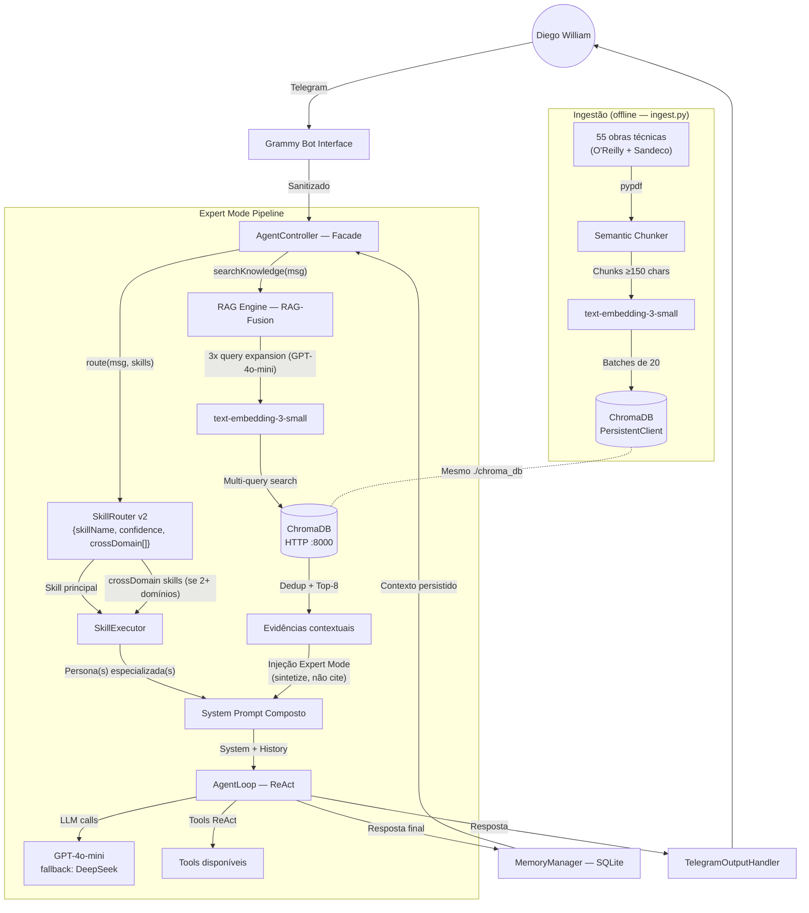

# Spec: Architecture — DiegoClaw RAG Expert Mode

**Versão:** 2.0  
**Status:** Aprovada  
**Autor:** DiegoClaw Squad (Antigravity)  
**Data:** 2026-05-13  
**Reviewer:** Diego William  
**Substitui:** v1.0 (architecture.md — RAG retrieval simples)

---

## 1. Visão Geral

O DiegoClaw opera em **Expert Mode**: um padrão de RAG onde o LLM não recupera e repete trechos — ele usa o conhecimento recuperado como **fundamento silencioso de raciocínio**, produzindo respostas de consultoria sênior.

A arquitetura combina **RAG-Fusion** (busca multi-query), **personas especializadas por domínio** e **roteamento cross-domain** para perguntas que cruzam múltiplas áreas de conhecimento.

---

## 2. Diagrama Arquitetural



---

## 3. Skill System — 8 Personas Especializadas

| Skill | Domínio Principal | Obras base | Cross-domain com |
|---|---|---|---|
| `ia-engineer` | Agentes, RAG, LLMs, MCP, Prompts | 29 obras | `data-engineer`, `devops` |
| `data-engineer` | Spark, Delta Lake, ETL, Lakehouse | 10 obras | `ia-engineer`, `python-developer` |
| `software-engineer` | Clean Code, DDD, TDD, Arquitetura | 6 obras | `python-developer`, `devops` |
| `automations` | MCP, n8n, integrações, segurança | 4 obras | `ia-engineer` |
| `devops` | Docker, Kubernetes, FastAPI, Infra IA | 4 obras | `software-engineer` |
| `python-developer` | Python avançado, async, type hints | 4 obras | `software-engineer` |
| `project-manager` | PMBOK, roadmaps, gestão de projetos IA | 4 obras | `ia-engineer` |
| `diegoclaw-assistant` | Assistente geral (fallback) | — | — |

### 3.1 Cross-Domain Routing

```
Pergunta: "Como arquitetar RAG em cima de um Data Lakehouse Delta Lake?"
  ↓
SkillRouter.route() → {
  skillName: "ia-engineer",
  confidence: 0.95,
  crossDomain: ["data-engineer"]
}
  ↓
AgentController monta prompt:
  [ia-engineer persona] + [data-engineer perspectiva] + [evidências RAG deduplicadas]
```

---

## 4. RAG Expert Mode — Injeção de Evidências

### 4.1 Diferença crítica vs. RAG v1

| RAG v1 (descontinuado) | RAG Expert Mode (v2) |
|---|---|
| "Use este contexto quando pertinente" | "Você já domina — sintetize, não cite" |
| LLM parafraseia os trechos | LLM usa como raciocínio, entrega consultoria |
| Resposta = reformulação do livro | Resposta = aplicação ao problema de Diego |

### 4.2 RAG-Fusion Pipeline

```
Query original
  ↓ GPT-4o-mini gera 3 variações (técnica, conceitual, prática)
  ↓ 4 queries em paralelo → embeddings text-embedding-3-small
  ↓ ChromaDB multi-query (nResults=5 por query)
  ↓ Deduplicação por ID → Top-8 trechos únicos
  ↓ Injeção como "evidências de raciocínio" no system prompt
```

---

## 5. Infraestrutura RAG

### 5.1 Ingestão (Python — PersistentClient)

```
python ingest.py          # Ingere arquivos novos (incremental)
python ingest.py --status # Relatório do banco
python ingest.py --force  # Re-ingere tudo
```

Processo: `pypdf` extrai texto → chunking por parágrafos (≥150 chars) → batches de 20 → `text-embedding-3-small` → ChromaDB `PersistentClient` (escrita direta em `./chroma_db`)

### 5.2 Servidor (HTTP — para o bot Node.js)

```
start_rag_server.bat   # python -c "...chroma run --path ./chroma_db --port 8000"
```

### 5.3 Bot Node.js — ChromaClient HTTP

```
src/utils/rag.ts → ChromaClient({ host: 'localhost', port: 8000 })
Fallback gracioso: se offline → modo LLM puro, sem crash
```

---

## 6. Modelo de Dados — ChromaDB

```
Collection: diegoclaw_knowledge
Schema por chunk:
  id:       MD5(filename + chunk_index)
  document: texto do chunk (≥150 chars)
  metadata: {
    source: "SPARK O GUIA DEFINITIVO.pdf",
    type:   "technical_book" | "note"
  }
  embedding: [1536 dims — text-embedding-3-small]
```

---

## 7. Sequência de Inicialização

```
1. [Uma vez] python ingest.py           → popula ./chroma_db
2. start_rag_server.bat                 → ChromaDB HTTP :8000
3. start_diegoclaw_local.bat            → Bot Telegram
```

---

## 8. Segurança e Privacidade

- ChromaDB roda apenas em `localhost` — sem exposição externa
- Secrets (OpenAI, Telegram) exclusivamente via `.env`
- Whitelist Telegram via `TELEGRAM_ALLOWED_USER_IDS`
- Sanitização de prompt injection no `TelegramInputHandler`
